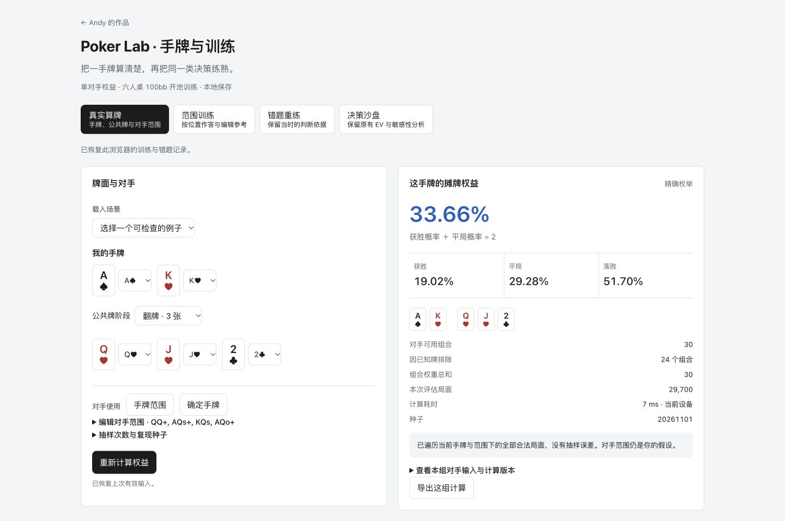
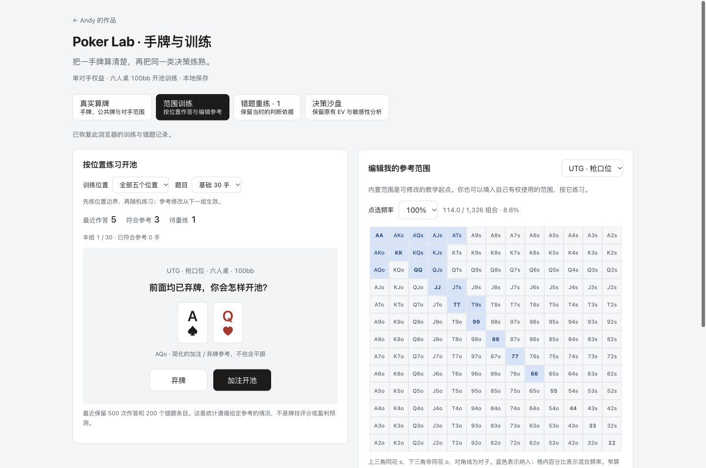

# Poker Lab · 手牌与训练

[在线体验](https://andyzhang666666.github.io/poker-ev-calculator/) · [范围训练](https://andyzhang666666.github.io/poker-ev-calculator/#practice) · [错题重练](https://andyzhang666666.github.io/poker-ev-calculator/#review) · [English](README.en.md)

从一手牌的权益计算，到按位置练习，再把错题留到下次。

Poker Lab 在原有单轮 EV 沙盘上，增加了真实牌面计算、可编辑的位置范围和带参考快照的错题本。无需账号或 API Key，计算和记录都留在当前浏览器。原来的 EV、敏感性分析与八个案例继续保留。

## 可以做什么

| 工作区 | 用法 | 计算或参考口径 |
| --- | --- | --- |
| 真实算牌 | 输入两张手牌、公共牌、对手确定手牌或加权范围 | 单对手摊牌权益；排除已知牌，计入平局分池；小规模精确枚举，其余固定种子抽样 |
| 范围训练 | 编辑 13×13 范围，练习基础 30 手或随机 10 手 | 六人现金桌、100bb、前面均弃牌、加注/弃牌教学参考；支持混合频率 |
| 错题重练 | 自动保留偏离参考的题目，重练、归档与备份 | 保存答错时的手牌、位置和范围；连续两次重练符合参考后标记已巩固 |
| 原 EV 沙盘 | 比较单轮行动与强度误差，导出比较 | 手动强度和对手行为假设，保留原有模型边界 |

## 建议体验

1. 在“真实算牌”载入 **转牌 · AA 对 KK**：44 个合法河牌，权益为 42/44。再看公共牌同花顺的平局，以及加权范围案例。
2. 进入“范围训练”，先练基础题，再改变某个位置的范围。新范围从下一组生效，混合策略中的两种支持动作都可以通过。
3. 到“错题重练”继续作答。刷新页面后记录仍在；可导出备份，在另一台设备导入。修改新范围不会改写旧题依据。





截图来自本地验收。训练中的作答数量为构造测试记录，不是实际用户数据。

## 这次增加的产品与实现

- **从强度假设到牌面计算。** 接入牌型评估，补齐范围解析、组合权重、已知牌排除、精确枚举和可复现抽样；在独立计算线程中运行，可停止计算。
- **从看范围到练决策。** 位置范围、矩阵编辑、文字输入和出题共用同一份参考。随机题按真实两张牌组合抽样，避免把对子、同花与非同花误当成等概率类别。
- **从累计对错到保留依据。** 每道错题保存当时的参考与具体牌面。修改范围不改写旧题，混合频率不被简化为单一标准答案。
- **把恢复做进流程。** 输入变更会标出旧结果并禁用其导出；本地保存失败有提示，备份导入会校验内容并合并去重。

## 来源与许可

牌型引擎使用 [phe 0.6.0](https://github.com/thlorenz/phe)（MIT）。矩阵键盘移动和组合计数改编自 [n1kFord/preflop-range-trainer](https://github.com/n1kFord/preflop-range-trainer)（MIT）。原项目版权与许可保留在 [third-party](third-party/)；具体复用位置及本项目扩展见 [来源说明](docs/THIRD-PARTY.md)。

本项目新增范围加权计算与线程调度、教学题组、参考快照、错题生命周期、备份校验及验证脚本。内置参考由本项目编写，不是从商业求解器导出的 GTO 数据。没有接入大模型、云账号或实时牌桌。

## 开发与验证

Node.js 22.18+，Next.js 15.5 / React 19.1 / TypeScript，静态导出到 GitHub Pages。

```sh
npm ci
npm run check
npm run build
npm run preview
```

预览地址为 `http://127.0.0.1:8854/poker-ev-calculator/`，必须保留仓库前缀。开发时也可运行 `npm run dev`。修改通过功能提交、修复提交和文档记录分别保留；PR 检查及 main 发布都执行模型校验和构建。

[本轮实现与验证](docs/POKER-LAB-20261101.md) · [计算与参考说明](docs/POKER-METHODS.md) · [更新记录](CHANGELOG.md)

**适用范围：** 这里计算给定范围下的摊牌权益，不包含抽水、多人边池和未来下注。训练衡量对给定参考的遵循情况，不是完整策略求解或盈利预测。详细口径可在界面与方法说明中查看。

<details>
<summary>原 EV 决策沙盘：模型、实现与历史验证</summary>

[在线体验](https://andyzhang666666.github.io/poker-ev-calculator/) · [模型假设](docs/ASSUMPTIONS.md) · [验收记录](docs/VALIDATION.md)

不只比较哪个行动的 EV 高，也看强度估错一点时，结论是否切换。一个无需登录、无需 API Key、浏览器本地运行的单轮决策模型练习工具。

## 体验路径

1. 选择手牌，或载入 8 个固定案例。公共牌仅记录场景，不会自动更新强度。
2. 调整底池、筹码、强度和对手假设，比较弃牌 / 跟注 / 加注的模型收益。
3. 设置强度误差范围，在其他假设固定时逐点检查行动是否切换。这个范围是用户输入，不是统计置信区间。
4. 查看完整敏感性曲线；导出带有输入、模型版本、结果和局限的 JSON 决策记录。

参数草稿仅保存在当前浏览器；无存储权限或旧草稿损坏时仍能计算，并有恢复提示。恢复默认会重置参数，不会上传任何内容。零筹码时不再生成行动建议或导出记录。

## 计算口径

纯函数位于 `src/lib/ev.ts`。设 P 为对手本次行动**之前**的底池，B 为对手本次下注，C = min(B, 我方筹码)，E = min(B, C)：

```text
模型胜率 w = clamp(强度/100 + 类型修正 + 行动修正, 5%, 95%)
弃牌 EV = 0 （已投入的筹码是沉没成本）
跟注 EV = w × (P + E) − (1 − w) × C
跟注门槛 = C / (P + E + C)
```

短筹码时，不能争夺的超额下注不进入赔率。例如底池 100、对手下注 1000、我方仅余 10，门槛为 10/120，而不是 10/1110。赔率与跟注 EV 使用同一金额口径。

加注仍使用固定尺度（有下注时 3 倍；过牌时 2/3 底池，受有效筹码限制），并使用硬编码弃牌率与被跟后的胜率折价。该分支不是合法下注历史裁判，也不优化下注尺度。

赔率概念参考 [PokerStars Learn](https://www.pokerstars.com/poker/learn/lesson/pot-odds/)；有效参与资金的规则背景见 [PokerStars 规则说明](https://www.pokerstars.com/help/articles/poker-rules-master/229151/)。这些规则来源不构成对本项目胜率常数的校准。

## 产品判断与边界

- 把“当前假设下较优”与“真实牌局最优”分开。强度表是可玩性评分，不是实际胜率；对手参数没有真实牌局拟合。
- 展示输入误差造成的行动切换，比给一个无条件的建议更有解释力。但这里只改变强度，不覆盖所有模型不确定性。
- 案例一致性是回归测试，不是策略正确率。8 个预设案例沿用原有参数，不能作为独立验证集。
- 单对手、单轮、无抽水、无后续街；不建模多人边池、位置、对手真实范围与行动历史。公共牌不参与自动计算。
- 仅用于学习模型与交互设计，不是 GTO 求解器，也不应用于真钱下注建议。

## 开发与验证

Next.js 15 / React 19 / TypeScript / CSS Modules / Chart.js；静态导出到 GitHub Pages。敏感性图按需加载，保留四个原有工作区。

```bash
npm ci
npm run dev
npm run check       # 生成固定案例 + 原有断言 + 新增边界测试
npm run build       # out/ 静态导出
```

真实浏览器验收（先启动静态服务器；需要 Playwright 与 Chrome）：

```bash
TEST_URL=http://localhost:8804/poker-ev-calculator/ node scripts/test-browser.mjs
```

可用 `PLAYWRIGHT_MODULE` 指定 Playwright 模块，`EVIDENCE_DIR` 指定截图和导出文件目录。浏览器验收覆盖短筹码、零筹码、键盘移除公共牌、8 个案例、草稿恢复、损坏/禁用存储，以及四个工作区 × 1440/768/390/360px。

## License

MIT（沿用本仓库既有许可）。

</details>
