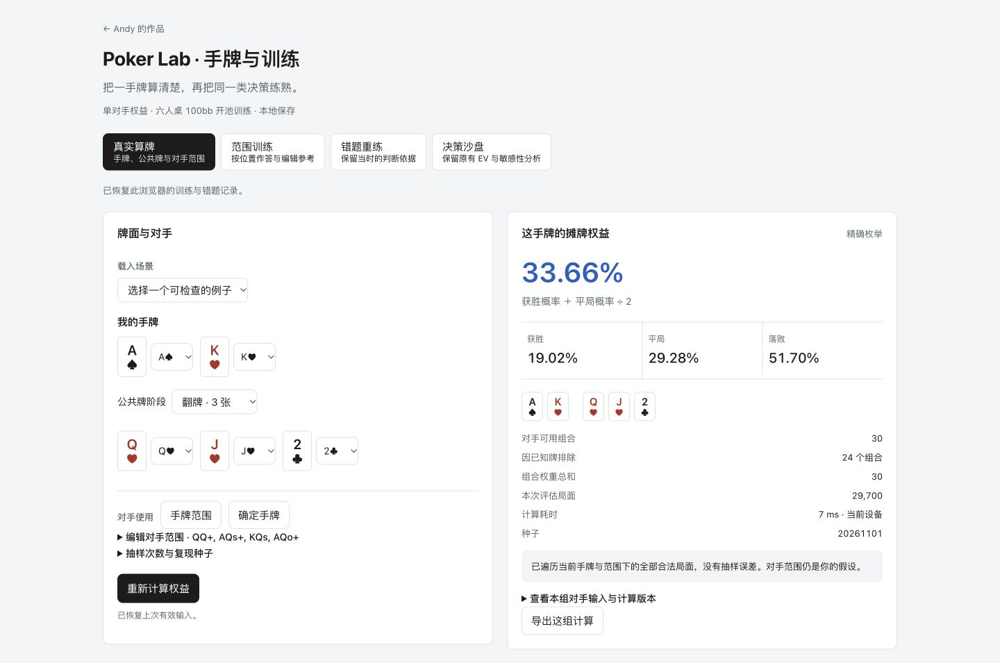
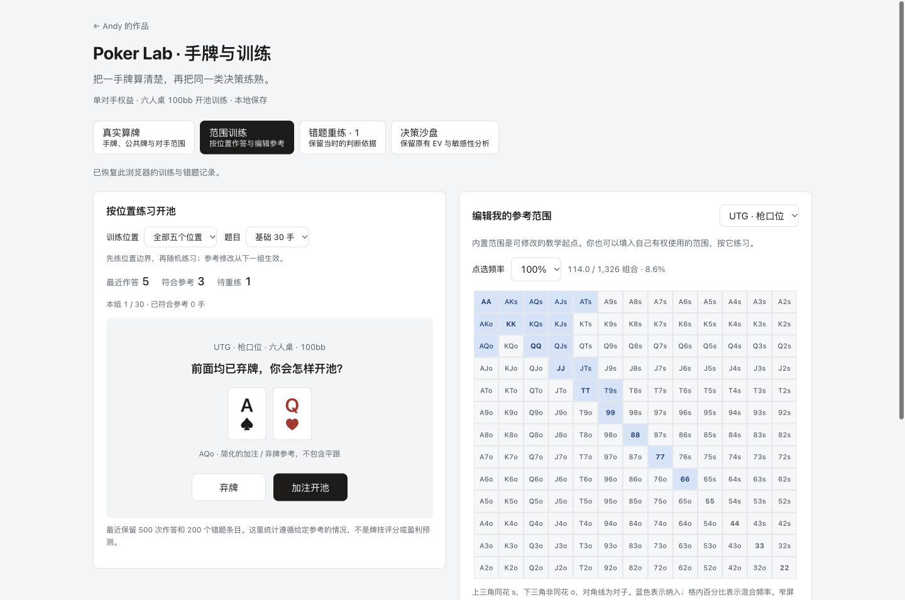
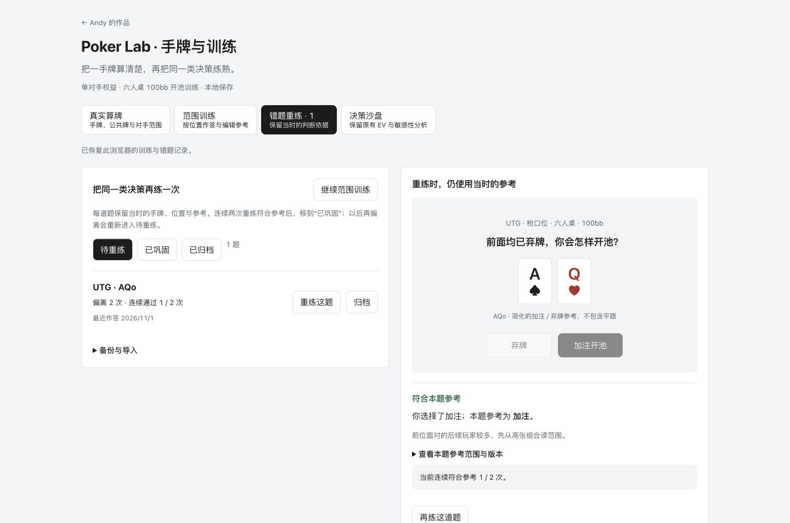
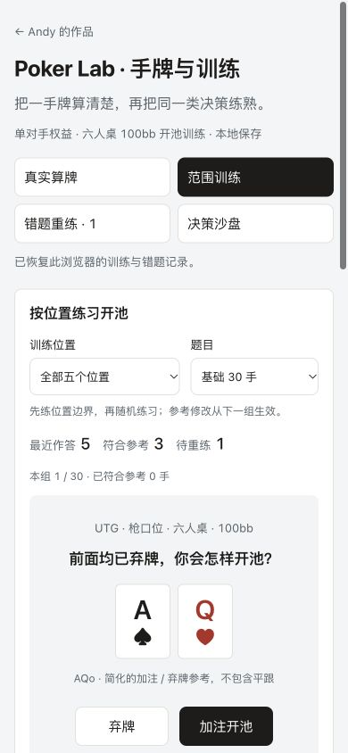

# Poker Lab 0.2：实现与验证

日期：2026-11-01。范围为真实算牌、开池范围训练、错题重练，以及官网入口整合。保持原 URL、灰白面板与墨色操作按钮；旧 EV 沙盘的四个面板继续存在。

## 已实现

真实算牌从实际牌面和对手组合计算，支持确定手牌或加权范围、已知牌排除、平局分池、精确枚举与固定种子抽样。计算在 worker 运行，旧结果保留其输入与版本；新输入未计算完成时不能导出旧结果冒充新结果。

训练提供五个位置参考、30 手基础题和随机十手组。矩阵与文字编辑同源，参考变化从下一组生效。错题保存原参考，连续两次重练符合参考后进入已巩固，再次偏离会重新打开。支持可恢复归档、导出、导入校验与去重合并。

本轮按功能、复核修正与说明分别提交，提交内容与验证记录可以逐项对照。

## 执行结果

| 检查 | 实际结果 |
| --- | --- |
| npm run check | 24 组 Node 测试通过；原有八个固定 EV 案例与旧模型预期一致 |
| 独立牌型对照 | 1,500 组固定/随机五至七张牌比较，使用另写的五张牌子集枚举器对照生产查表引擎 |
| 计算边界 | 0%/100% 确定结果、公共牌平局、加权范围、已知牌排除、非法输入、空范围、固定种子与抽样对照均通过 |
| 参考与记录 | 混合频率、改范围不回写旧题、重练两次、再次偏离、重复作答去重、损坏导入拒绝均通过 |
| 保留规模 | 500 次作答及高精度自定义范围的完整备份，可通过同一解码器重新导入 |
| 生产构建 | Next.js 静态导出与 TypeScript 检查通过，仓库前缀和独立 worker 产物存在 |
| 依赖 | 在原版本系列内更新补丁并锁定传递依赖；检查结果见下方原始记录 |
| 样式静态检查 | design-taste-frontend：0 FAIL / 1 WARN；警告仅为范围文字输入使用等宽字体，用于阅读机器可解析的范围记法 |

原始输出：[模型与单元检查](../results/check-20261101.txt)、[依赖检查](../results/dependency-audit-20261101.json)、[生产构建](../results/build-20261101.txt)。

## 真实浏览器流程

使用桌面应用的内置浏览器，对静态导出执行以下操作：

1. 转牌 AA 对 KK 显示 95.45%，对应 42/44；公共牌同花顺显示 100% 平局、50% 权益；加权河牌范围显示 75% 权益。
2. 翻牌前大树进入蒙特卡洛，固定种子重复计算均显示 43.00%；这只是该输入的验收结果，不是模型准确率或跨设备性能基准。
3. 输入改变后旧结果带归属提示，导出禁用；清空对手范围会显示可恢复的错误。非法范围频率不覆盖当前有效范围。
4. 矩阵方向键可移动到相邻格；改 UTG 参考后，新一组 AQo 的判断随之变化。
5. 构造偏离作答后自动进入错题本；刷新恢复；连续两次重练后进入已巩固；再一次偏离重新进入待重练；归档后可从已归档栏移回。
6. 导出的三次构造作答/一个错题备份经解码器校验，并在界面重新导入；作答仍为三次。无效文件被拒绝，不覆盖当前记录。
7. 原 EV 沙盘零筹码禁用导出，恢复筹码后可用；八个旧案例分别载入后仍进入原计算面板。
8. 四个主工作区在实际 1440、768、390、360px 宽度均无页面横向溢出。矩阵保留自己的横向滚动区域。具体宽度记录见 [JSON](viewport-checks-20261101.json)。

验收截图使用构造的本地作答记录，所有计数都不是实际用户数据。最后一轮浏览器日志未出现页面错误。原脚本 scripts/test-browser.mjs 保留并明确指向旧 #calc；本轮没有将它的所有历史场景冒充重新跑过，而是按上述实际流程记录。

## 官网整合

官网仍保留 17 项作品和三个德州入口。Poker Lab 卡片、中英文说明与简短开池试玩使用原有配色、字体和扑克牌模块。试玩是独立教学题，进入完整工具后开始该工具的训练流程，不伪装跨页面同步。

官网资料回归检查确认：其余 16 项作品和个人资料未改；HTML 除目标卡片、缓存版本与新增局部资源引用外保持原样。英文与四套原主题切换已检查。独立工具的业务逻辑仍在本仓库维护。

## 范围与未验证部分

这是单对手权益与给定参考训练，未做完整 GTO、多街下注、抽水、多人边池、锦标赛 ICM、云账号或大模型教练。没有真实用户效果、盈利预测或对手行为校准。

本轮未执行完整 WCAG 审计、全浏览器矩阵和 Lighthouse 评分。浏览器存储保护包含实际的不可读记录恢复检查；不同平台的全部额度与隐私模式组合未逐一覆盖。

上线状态以 GitHub 主分支部署记录和发布后的页面检查为准，不把本地构建通过等同于已发布。
